# Sơ Đồ Kiến Trúc Chi Tiết: Neuro-Symbolic SkateFormer với Fuzzy AND/OR Logic Tree

Hệ thống kết hợp giữa **Deep Learning (SkateFormer backbone)** và **Symbolic Reasoning (Fuzzy AND/OR Logic Tree)** thông qua **9 Spatial-Temporal Concept Groups** cùng ràng buộc tri thức (Knowledge Graph Ontology).

---

## 1. Sơ Đồ Tổng Thể Kiến Trúc (Mermaid Diagram)

```mermaid
flowchart TB
    %% STYLING DEFINITIONS
    classDef inputStyle fill:#1e293b,stroke:#94a3b8,stroke-width:2px,color:#f8fafc;
    classDef backboneStyle fill:#1e3a8a,stroke:#60a5fa,stroke-width:2px,color:#f8fafc;
    classDef headStyle fill:#065f46,stroke:#34d399,stroke-width:2px,color:#f8fafc;
    classDef ontologyStyle fill:#78350f,stroke:#fbbf24,stroke-width:2px,color:#f8fafc;
    classDef fuzzyTreeStyle fill:#581c87,stroke:#c084fc,stroke-width:2px,color:#f8fafc;
    classDef outputStyle fill:#831843,stroke:#f472b6,stroke-width:2px,color:#f8fafc;
    classDef lossStyle fill:#374151,stroke:#9ca3af,stroke-dasharray: 4 4,color:#f3f4f6;

    %% 1. INPUT
    subgraph S_INPUT ["1. Input Skeleton Stream"]
        X["Input Skeleton Sequence<br/><b>X ∈ ℝ^(B × C × T × V × M)</b><br/><i>(C: coords, T: frames, V: joints, M: persons)</i>"]:::inputStyle
    end

    %% 2. BACKBONE
    subgraph S_BACKBONE ["2. Spatial-Temporal Neural Backbone"]
        SKATE["<b>SkateFormer Backbone</b><br/>• Skeletal-Temporal Transformer Blocks<br/>• Spatial-Temporal Partition Attention<br/>• Global Average Pooling"]:::backboneStyle
        FEAT["Extracted Feature Vector<br/><b>feat ∈ ℝ^(B × feat_dim)</b><br/><i>(feat_dim = 192 hoặc 384)</i>"]:::backboneStyle
    end

    X --> SKATE --> FEAT

    %% 3. BRANCHING: DIRECT NEURAL VS CONCEPT BOTTLENECK
    subgraph S_NEURAL_REF ["3A. Auxiliary Direct Neural Branch (Reference Benchmark)"]
        FC_ACTION["Direct Linear Classifier<br/><b>Linear(feat_dim, C_actions)</b>"]:::outputStyle
        NEURAL_LOGITS["Neural Action Logits<br/><b>y_neural ∈ ℝ^(B × C_actions)</b><br/><i>(Giữ làm baseline upper-bound, KHÔNG fuse)</i>"]:::outputStyle
        L_NEURAL["Loss ℒ_neural_action<br/><b>CrossEntropy(y_neural, label)</b>"]:::lossStyle
        FC_ACTION --> NEURAL_LOGITS -.-> L_NEURAL
    end

    subgraph S_CONCEPT_BOTTLENECK ["3B. 9 Spatial-Temporal Concept Group Heads"]
        direction TB
        subgraph ANATOMICAL ["Anatomical Spatial Groups (6 Heads)"]
            H_HEAD["Head Group Head<br/><i>(head_)</i>"]:::headStyle
            H_HAND["Hand & Two-Person Head<br/><i>(hand_, interaction_two_person)</i>"]:::headStyle
            H_ARM["Arm Group Head<br/><i>(arm_)</i>"]:::headStyle
            H_HIP["Hip Group Head<br/><i>(hip_)</i>"]:::headStyle
            H_LEG["Leg Group Head<br/><i>(leg_)</i>"]:::headStyle
            H_FOOT["Foot Group Head<br/><i>(foot_)</i>"]:::headStyle
        end

        subgraph TEMPORAL ["Temporal Dynamics Groups (3 Heads)"]
            H_TDIR["Temporal Direction Head<br/><i>(temporal_direction_)</i>"]:::headStyle
            H_TSEQ["Temporal Sequence Head<br/><i>(temporal_sequence_)</i>"]:::headStyle
            H_TDYN["Temporal Dynamics Head<br/><i>(temporal_dynamics_)</i>"]:::headStyle
        end

        MLP_DESC["Cấu trúc mỗi Head: <b>Linear(feat_dim, 128) → GELU → Linear(128, 128) → GELU → Linear(128, n_k)</b>"]:::headStyle
        CONCAT_PROBS["Concatenated Concept Probabilities<br/><b>P ∈ [0, 1]^(B × 74)</b><br/><i>(Sigmoid sau mỗi head)</i>"]:::headStyle
    end

    FEAT --> FC_ACTION
    FEAT --> H_HEAD & H_HAND & H_ARM & H_HIP & H_LEG & H_FOOT
    FEAT --> H_TDIR & H_TSEQ & H_TDYN

    H_HEAD & H_HAND & H_ARM & H_HIP & H_LEG & H_FOOT --> CONCAT_PROBS
    H_TDIR & H_TSEQ & H_TDYN --> CONCAT_PROBS

    %% 4. ONTOLOGY & CONCEPT LOSSES
    subgraph S_ONTOLOGY ["4. Knowledge Graph & Ontology Supervision"]
        CSV_ONTO["Action-Concept Ontology Matrix<br/><b>M_concept ∈ {0, 1}^(C_actions × 74)</b><br/><i>(Gán nhãn từ CSV chuyên gia)</i>"]:::ontologyStyle
        JACCARD["KG Jaccard Semantic Similarity<br/><b>S_KG ∈ ℝ^(C_actions × C_actions)</b>"]:::ontologyStyle
        KG_MASK["KG-Neighbor Candidate Mask<br/><b>CandidateMask ∈ {0, 1}^(C_actions × 74)</b><br/><i>(Top-k neighbor concepts per class)</i>"]:::ontologyStyle
        L_CONCEPT["Loss ℒ_concept_bce<br/><b>Weighted-BCE(logits, target_concept)</b>"]:::lossStyle
        L_COLLAPSE["Loss ℒ_collapse<br/><b>-log(Var_batch(P_j) + 1e-4)</b><br/><i>(Phạt concept collapse về hằng số 0)</i>"]:::lossStyle

        CSV_ONTO --> JACCARD --> KG_MASK
        CSV_ONTO -.-> L_CONCEPT
        CONCAT_PROBS -.-> L_CONCEPT
        CONCAT_PROBS -.-> L_COLLAPSE
    end

    %% 5. FUZZY LOGIC TREE
    subgraph S_FUZZY_TREE ["5. Fuzzy AND/OR Logic Tree (Neuro-Symbolic Reasoning)"]
        direction TB

        subgraph LEAF_LAYER ["Tầng Lá (Leaves: 2^depth = 16 leaves/class)"]
            LEAF_SEL["Leaf Selector Softmax (có KG-Mask):<br/><b>sel = Softmax(W_leaf / T)</b><br/><i>(Chỉ chọn trong candidate pool của class)</i>"]:::fuzzyTreeStyle
            LEAF_POL["Polarity Gate (Soft NOT):<br/><b>pol = Sigmoid(W_pol / T)</b><br/><i>literal = pol · p + (1 - pol) · (1 - p)</i>"]:::fuzzyTreeStyle
            LEAF_VAL["Giá trị Literals tại các lá:<br/><b>v_leaf ∈ [0, 1]^(B × C_actions × 16)</b>"]:::fuzzyTreeStyle
            LEAF_SEL & LEAF_POL --> LEAF_VAL
        end

        subgraph INTERNAL_NODES ["Tầng Node Trung Gian (15 Gate Nodes/class)"]
            GATES["Fuzzy Gates (t-norm / t-conorm):<br/><b>AND(a, b) = a · b</b><br/><b>OR(a, b) = a + b - a · b</b><br/><b>node = β · AND(a, b) + (1 - β) · OR(a, b)</b><br/><i>(β = Sigmoid(W_gate / T))</i>"]:::fuzzyTreeStyle
            TEMP_SCHEDULE["Temperature Annealing:<br/><b>T: 1.0 → 0.05</b> qua 30 epochs<br/><i>(Ép dần cấu trúc về rời rạc)</i>"]:::fuzzyTreeStyle
        end

        LEAF_VAL --> GATES
        TEMP_SCHEDULE -.-> LEAF_SEL & LEAF_POL & GATES
    end

    CONCAT_PROBS --> LEAF_SEL
    KG_MASK --> LEAF_SEL

    %% 6. TREE OUTPUT & HARDENING
    subgraph S_OUTPUT ["6. Decision & Dual-Mode Inference"]
        TREE_LOGITS["Tree Output Probabilities<br/><b>P_tree ∈ [0, 1]^(B × C_actions)</b>"]:::outputStyle

        subgraph S_HARDEN ["Hardening & Rulebook Extraction"]
            HARDEN_PROC["Hardening Bước 1 & 2:<br/>• argmax(leaf_logits) chọn cứng 1 concept<br/>• Threshold Polarity (>0.5 → Identity, ≤0.5 → NOT)<br/>• Threshold Gate (β > 0.5 → AND, ≤0.5 → OR)<br/>• Binarization giá trị: v = (v > 0.5).float()"]:::outputStyle
            RULE_TEXT["Explicit Boolean Rulebook per Class:<br/><b>Action_c = (c₁ ∧ ¬c₂) ∨ (c₃ ∧ c₄) ...</b><br/><i>(Giải thích minh bạch 100% nguyên nhân phân loại)</i>"]:::outputStyle
            HARDEN_PROC --> RULE_TEXT
        end

        TREE_LOGITS --> HARDEN_PROC
    end

    GATES --> TREE_LOGITS

    %% 7. TREE LOSSES
    subgraph S_TREE_LOSS ["7. Tree Regularization & Losses"]
        L_TREE_CE["Loss ℒ_tree_ce<br/><b>CrossEntropy(log(P_tree), label)</b>"]:::lossStyle
        L_TREE_ENTROPY["Loss ℒ_tree_entropy<br/><b>Entropy(sel) + Entropy(pol) + Entropy(gate)</b>"]:::lossStyle
        L_DIVERSITY["Loss ℒ_leaf_diversity<br/><b>Phạt trùng lặp concept giữa các lá</b>"]:::lossStyle

        TREE_LOGITS -.-> L_TREE_CE
        LEAF_SEL & LEAF_POL & GATES -.-> L_TREE_ENTROPY
        LEAF_SEL -.-> L_DIVERSITY
    end

    %% TOTAL LOSS
    subgraph S_TOTAL_LOSS ["Total Joint Objective"]
        L_TOTAL["<b>ℒ_total = ℒ_tree_ce + λ_ent·ℒ_tree_entropy + λ_div·ℒ_leaf_diversity<br/>+ λ_c·ℒ_concept_bce + λ_col·ℒ_collapse + 0.20·ℒ_neural_action</b>"]:::lossStyle
    end

    L_TREE_CE & L_TREE_ENTROPY & L_DIVERSITY & L_CONCEPT & L_COLLAPSE & L_NEURAL -.-> L_TOTAL
```

---

## 2. Chi Tiết Từng Module Trong Kiến Trúc

### 2.1. Input & Spatial-Temporal Backbone
- **Đầu vào**: Tensor khung xương $X \in \mathbb{R}^{B \times C \times T \times V \times M}$ với:
  - $B$: Batch size
  - $C = 3$: Toạ độ 3D $(x, y, z)$
  - $T$: Số lượng frames thời gian (mặc định 64)
  - $V = 25$: Số lượng khớp trên cơ thể (chuẩn NTU-RGB+D)
  - $M = 2$: Số người tối đa trong khung hình.
- **SkateFormer Backbone**: Áp dụng Partition Attention theo cả chiều không gian và thời gian, trích xuất đặc trưng toàn cục $f \in \mathbb{R}^{B \times d_{\text{feat}}}$ ($d_{\text{feat}} = 192$ hoặc $384$).

### 2.2. Nhánh Tham Chiếu Độc Lập (Direct Neural Action Branch)
- **Cấu trúc**: Tuyến tính $\text{Linear}(d_{\text{feat}}, C_{\text{actions}})$.
- **Vai trò**: Hoạt động như một **mốc tham chiếu trên (upper-bound accuracy benchmark)** (~92.4% trên tập NTU-60 CS).
- **Điểm cải tiến cốt lõi**: **Không fusion** $\alpha$-blend vào ngõ ra của cây logic, đảm bảo kết quả phân loại cuối cùng mang tính chất diễn giải tượng trưng (Symbolic) hoàn toàn.

### 2.3. 9 Spatial-Temporal Concept Group Heads
74 concepts định trước được phân rã thành 9 nhóm độc lập tương ứng với các bộ phận cơ thể và đặc trưng chuyển động:
1. **`head`** (6 concepts): cử động đầu (quay, ngửa, nghiêng...).
2. **`hand`** (12 concepts): chạm tay, đập tay, bắt tay, chỉ trỏ...
3. **`arm`** (8 concepts): vung tay, giơ tay cao, khoanh tay...
4. **`hip`** (5 concepts): cúi gập hông, ngồi, xoay hông...
5. **`leg`** (9 concepts): co chân, đá chân, bước đi...
6. **`foot`** (4 concepts): dậm chân, nhảy, kiễng gót...
7. **`temporal_direction`** (10 concepts): hướng chuyển động chính (lên, xuống, ngang, tới, lui...).
8. **`temporal_sequence`** (10 concepts): giai đoạn hành vi (khởi phát, tăng tốc, đạt đỉnh, kết thúc...).
9. **`temporal_dynamics`** (10 concepts): động lực học (nhanh, chậm, đột ngột, nhịp nhàng...).

Mỗi group head là một mạng MLP riêng:
$$\text{Head}_k(f) = W_3 \cdot \text{GELU}(W_2 \cdot \text{GELU}(W_1 \cdot f))$$
Sau đó tính xác suất qua hàm Sigmoid và ghép thành vector concept:
$$P \in [0, 1]^{B \times 74}$$

### 2.4. Ràng Buộc Tri Thức (Knowledge Graph / Ontology Constraint)
- **Ma trận Ontology $M_{\text{concept}} \in \{0, 1\}^{60 \times 74}$**: Lưu trữ sự hiện diện chuẩn của 74 concepts trong 60 hành động.
- **Độ đo tương đồng Jaccard**:
  $$S_{KG}(i, j) = \frac{|M_i \cap M_j|}{|M_i \cup M_j|}$$
- **KG Candidate Mask**: Mỗi hành động $c$ chỉ được phép chọn concept từ tập các concept của chính nó và $k$ hành động láng giềng gần nhất theo $S_{KG}$ ($k=8$). Điều này ngăn các lá chọn phải các khái niệm ngẫu nhiên không có căn cứ ngữ nghĩa.

### 2.5. Fuzzy AND/OR Logic Tree (Mô Đun Suy Luận Mờ)
Mỗi lớp hành động được gán một cây nhị phân (chiều sâu $\text{depth}=4 \implies 16$ lá, $15$ node trung gian):
- **Tầng Lá (Leaf Literals)**:
  - Selector: $\text{sel} = \text{Softmax}(W_{\text{leaf}} / T)$ kết hợp với KG Mask.
  - Polarity Gate (Cổng Phủ Định Mềm): $\text{pol} = \sigma(W_{\text{pol}} / T)$.
  - Giá trị chân lý tại lá:
    $$v_{\text{leaf}} = \text{pol} \cdot p + (1 - \text{pol}) \cdot (1 - p)$$
- **Tầng Node Trung Gian (Fuzzy Gates)**:
  - **Fuzzy AND (Product t-norm)**: $\text{AND}(a, b) = a \cdot b$
  - **Fuzzy OR (Probabilistic Sum t-conorm)**: $\text{OR}(a, b) = a + b - a \cdot b$
  - **Gate kết hợp**:
    $$\text{node} = \beta \cdot \text{AND}(a, b) + (1 - \beta) \cdot \text{OR}(a, b), \quad \beta = \sigma(W_{\text{gate}} / T)$$
- **Annealing Nhiệt Độ**: $T$ được giảm dần từ $1.0 \to 0.05$ trong suốt quá trình train để ép dần các cổng sang dạng rời rạc.

### 2.6. Hardening & Trích Xuất Luật Boolean (Explainable Rulebook)
Khi chuyển từ mô hình mềm sang mô hình cứng:
1. **Lá**: Chọn cứng 1 concept có logit lớn nhất ($\arg\max$).
2. **Polarity**: $W_{\text{pol}} > 0 \implies \text{Identity}$, ngược lại $\text{NOT}$.
3. **Gate**: $\beta > 0.5 \implies \text{AND}$, ngược lại $\text{OR}$.
4. **Binarization**: Ép giá trị chân lý của literal về $\{0, 1\}$:
   $$v_{\text{hard}} = \mathbb{I}(v > 0.5)$$
   *Điều này ngăn chặn hiện tượng AND dồn làm co giá trị theo cấp số nhân ở các công thức có độ sâu lớn.*
5. **Xuất luật**: Mỗi hành động sinh ra một công thức Boolean tường minh:
   $$\text{Drink\_Water} = ((\text{hand\_lift\_cup} \land \neg \text{foot\_kick}) \lor \dots)$$
