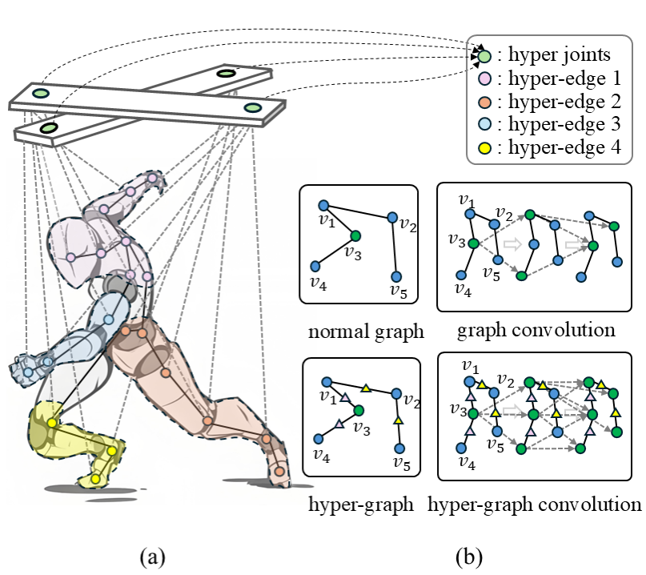
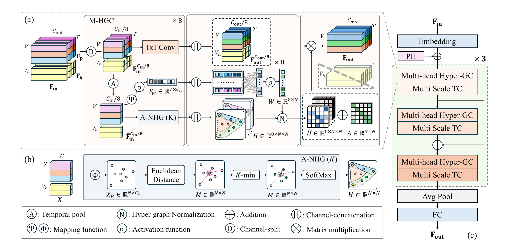
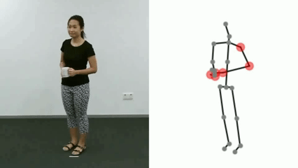
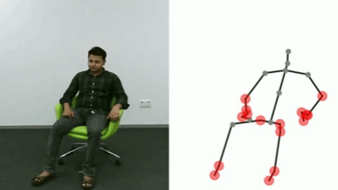
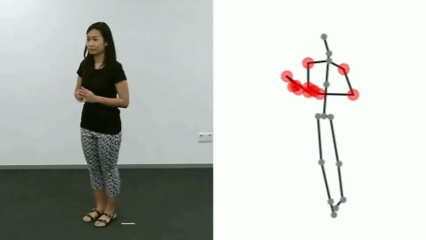
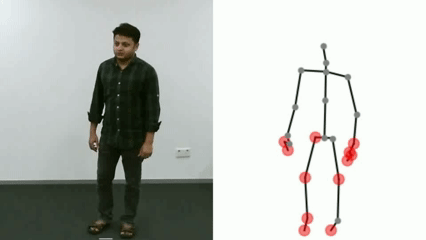
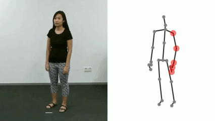
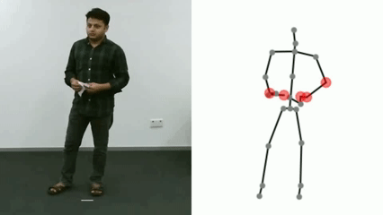
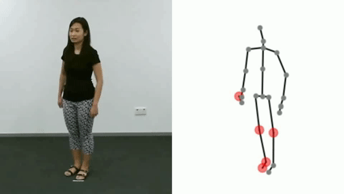
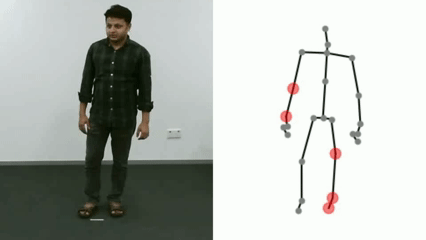

# Hyper-GCN
This repo is the official implementation for [Adaptive Hyper-Graph Convolution Network for Skeleton-based Human Action Recognition with Virtual Connections](https://arxiv.org/pdf/2411.14796). The paper is accepted to ICCV 2025.

# Illustration
<div align='center'>
   <br>
</div>
<!--  -->

**Illustration of Hyper-GCN.** 
In (a), dotted lines represent the virtualconnections. Each coloured part containing multiple joints represents a hyper-graph with hyper-edges. 
(b) provides an intuitive comparison between normal graph convolution and hyper-graph convolution operations with the same connectivity degree.

# Framework
<div align='center'>
   <br>
</div>

**The framework of Hyper-GCN.**
Part (a) represents the Multi-head Hyper-graph Convolution (M-HGC) module.
Part (b) represents the process of constructing an adaptive hyper-graph.
Part (c) represents the architecture of Hyper-GCN.

# Visualization
|  |  |  |  |
|:------------:|:------------:|:------------:|:------------:|
|*Drink water*|*Stand up*|*Clapping*|*Jump up*|
|  |  |  |  |
|*Neck pain*|*Wipe face*|*Hopping*|*Kicking something*|

There are some selected actions for visualizing the hyper-graph constructed by Hyper-GCN.

# Prerequisites
- Python == 3.9
- PyTorch == 1.13.0
- torchpack == 0.2.2
- numpy == 1.26.4
- PyYAML, tqdm, tensorboardX, matplotlib, sklearn, h5py

We provide the dependency file of our experimental environment, you can install all dependencies by creating a new anaconda virtual environment and running `pip install -r requirements.txt `

# Data Preparation

### Download datasets.

#### There are 3 datasets to download:

- NTU RGB+D 60 Skeleton
- NTU RGB+D 120 Skeleton
- NW-UCLA

#### NTU RGB+D 60 and 120

1. Request dataset here: https://rose1.ntu.edu.sg/dataset/actionRecognition
2. Download the skeleton-only datasets:
   1. `nturgbd_skeletons_s001_to_s017.zip` (NTU RGB+D 60)
   2. `nturgbd_skeletons_s018_to_s032.zip` (NTU RGB+D 120)
   3. Extract above files to `./data/nturgbd_raw`

#### NW-UCLA

1. Download dataset from [here](https://www.dropbox.com/s/10pcm4pksjy6mkq/all_sqe.zip?dl=0)
2. Move `all_sqe` to `./data/NW-UCLA`

### Data Processing

#### Directory Structure

Put downloaded data into the following directory structure:

```
- data/
  - NW-UCLA/
    - all_sqe
      ... # raw data of NW-UCLA
  - ntu/
  - ntu120/
  - nturgbd_raw/
    - nturgb+d_skeletons/     # from `nturgbd_skeletons_s001_to_s017.zip`
      ...
    - nturgb+d_skeletons120/  # from `nturgbd_skeletons_s018_to_s032.zip`
      ...
```

#### Generating Data

- Generate NTU RGB+D 60 or NTU RGB+D 120 dataset:

```
 cd ./data/ntu # or cd ./data/ntu120
 # Get skeleton of each performer
 python get_raw_skes_data.py
 # Remove the bad skeleton 
 python get_raw_denoised_data.py
 # Transform the skeleton to the center of the first frame
 python seq_transformation.py
```


# Training & Testing

### Training

- We provide the training configs for base and large version in 4 modalities (joint, bone, joint motion and bone motion) for each benchmark. 
You can change the config file depending on what you want. As a example for base version on NTU120 X-Sub with device 0:

```
# train for modality joint
python main.py --config config/base/nturgbd120-cross-subject/hyper_joint.yaml --work-dir <the save path of results> --device 0
# train for modality bone
python main.py --config config/base/nturgbd120-cross-subject/hyper_bone.yaml --work-dir <the save path of results> --device 0
# train for modality joint motion
python main.py --config config/base/nturgbd120-cross-subject/hyper_joint_motion.yaml --work-dir <the save path of results> --device 0
# train for modality bone motion
python main.py --config config/base/nturgbd120-cross-subject/hyper_bone_motion.yaml --work-dir <the save path of results> --device 0
```

### Testing

- You can test the trained models saved in `<the save path of results>` as the follow command:

```
python main.py --config <the save path of results>/config.yaml --work-dir <the save path of results> --phase test --save-score True --weights <the save path of results>/xxx.pt --device 0
```

- If you want to ensemble the results of 4 modalities for the final result, run the following command (As a example for base version on NTU120 X-Sub): 
```
python ensemble.py --datasets ntu120/xsub --model base --joint-dir <the save path of result on joint> --bone-dir <the save path of result on bone> --joint-motion-dir <the save path of result on joint motion> --bone-motion-dir <the save path of result on bone motion>
```

# Pretrained Models

## Symbolic branch: fine-tuning and monitoring

The configs in `config/symbolic/` and
`config/base/nturgbd120-cross-subject/hyper_joint_symbolic.yaml` require a
pretrained checkpoint. Select the official weights matching **base/large,
NTU60/NTU120, modality and split**, and the checkpoint's `hyper_joints` setting.
The configs in `config/symbolic/` use the baseline's SGD, augmentation, batch
size and schedule, with `base_lr: 0.0001` for full fine-tuning.
The active `hyper_joint_symbolic.yaml` instead runs a **one-stage concept-to-action
symbolic experiment**: 20 epochs, Adam LR 0.0003, a one-epoch warmup and LR decay
at epochs 12 and 17 (zero-based scheduler indices). It uses a separate
`joint_concept_action_adam` work directory, keeping previous experiments intact.
`num_worker: 0` is retained for Windows;
`save_epoch: 0` keeps every evaluated epoch available for best-model selection.
Weights initialize the model; optimizer/scheduler state and original training
epochs are not resumed. No dependency on the checkpoint filename is required.

```bash
python main.py --config config/base/nturgbd120-cross-subject/hyper_joint_symbolic.yaml --weights PATH_TO_OFFICIAL_CHECKPOINT.pt
```

`symbolic_only: True` freezes every pretrained parameter, including the original
classifier, and keeps pretrained BatchNorm statistics and dropout in eval mode.
With `symbolic_action_mode: prototype`, the original FC is retained only for
strict checkpoint compatibility and is never executed. The action logits are a
fixed, balanced Bernoulli log-likelihood match between 102 predicted concepts
and the 120 validated CSV templates. There is no learned action MLP or residual
feature path. Only concept query/bias and the concept-graph gate are optimized.
The loss is `action CE + 0.10 * balanced concept BCE`; divergence is not used.
This makes every action score decomposable into named concept contributions.

Before training, `eval_before_train: True` (also automatic in symbolic-only mode)
evaluates the initial concept decoder as epoch 0 and saves
`initial_evaluation.json` and `runs-0-0.pt`. Initialize directly from the same
official Hyper-GCN checkpoint as the baseline. The symbolic predictor starts
randomly and Adam jointly optimizes it using action CE and concept BCE; no
intermediate symbolic checkpoint or second configuration is required.
Each `epochN_test_action_metrics.json` reports Top-1 and its change in percentage
points from epoch 0. Improvements are saved independently of periodic saves;
if every trained epoch is worse, final evaluation restores epoch 0. Inspect
epoch-level concept metrics too: the action-best checkpoint may be the untrained
symbolic initialization. For final scientific comparisons, use a held-out
training validation split for model/threshold selection rather than test tuning.

To retain full fine-tuning, use
`config/symbolic/nturgbd120-cross-subject/hyper_joint.yaml` instead.

Only the new symbolic branch may be missing when `pretrained_finetune: True`
in train mode. Missing backbone/classifier keys, wrong tensor sizes and unexpected
keys fail rather than silently leaving pretrained layers uninitialized.
Test mode requires trained symbolic parameters. Old CSV-derived checkpoint
buffers are rebuilt from the validated current tables, not restored.

For a fair **full fine-tuning** baseline comparison, fine-tune the same official checkpoint using
the baseline config and the same fine-tuning LR and runtime options:

```bash
python main.py --config config/base/nturgbd120-cross-subject/hyper_joint.yaml --weights PATH_TO_OFFICIAL_CHECKPOINT.pt --pretrained-finetune True --base-lr 0.0001 --num-worker 0 --save-epoch 0 --work-dir work_dir/ntu120/xsub/joint_finetune_baseline
```

The concept CSV is validated against the NTU label order expressed by the v2.4
action names. Column counts, binary values, unique contiguous metadata IDs and
matching concept order are checked before building tensors. All rows are
validated, including unused NTU120 rows in NTU60 experiments. Anatomical mapping
correctly includes the head for hand-to-face/nose concepts and legs/feet for
`lower_limb_kick_targeted`; unknown spatial concepts require an explicit mapping.
The concept graph uses cosine similarity of class-support columns, unit
self-loops and row normalization. A concept with no support has only its self-loop.

The configs enable controlled BCE balancing:

```yaml
model_args:
  symbolic_balance_loss: True
  symbolic_pos_weight_source: train
  symbolic_pos_weight_max: 10.0
```

`train` computes concept frequencies from training labels and class templates,
without test labels. `class` instead assumes equal class frequencies. Positive
weights are `clip(negative_count / positive_count, 1, cap)`; concepts with no
positives use weight 1. Training class counts are saved with symbolic weights
and used to rebuild BCE weights in test mode. Set `symbolic_balance_loss: False`
for the unweighted ablation or evaluation of legacy symbolic checkpoints without
training counts. Balancing changes calibration: the F1 threshold remains fixed
at 0.5 (`--concept-threshold`); do not optimize it on test data.

Monitoring outputs in each experiment directory:

- TensorBoard: `loss/ce`, `loss/divergence`, `loss/symbolic`,
  `loss/symbolic_weighted`, and `symbolic/residual_gate`,
  `symbolic/concept_graph_gate` (after `tanh`).
- Evaluation: concept macro/micro F1 and mAP, plus spatial/temporal/context
  summaries in TensorBoard and `epochN_test_concept_metrics.json`.
- `symbolic_audit.json`: concept mappings, zero-based joint groups, positive
  class counts, training class frequencies and the actual BCE weights.

`macro_f1` and `mAP` exclude concepts without positive evaluation targets;
`macro_f1_all` includes every concept with zero F1 for undefined cases. Per-concept
reports show positive target/prediction counts and `AP: null` when no positives
exist. These are **action-class template targets**, not independent per-video
concept annotations; concept scores alone do not establish explanation quality.

CPU unit checks (no dataset training):

```bash
python -B -m unittest discover -s tests -v
```

We provide the pretrained weights, configs and training logs. 
You can download pretrained models for producing the final results on NTU 60 & 120 in [Google Drive](https://drive.google.com/drive/folders/1Zi6l8NL_mp7I7v8FjizlRNTk7wZlNfkQ?usp=sharing).

## Acknowledgements

- This repo is based on [CTR-GCN](https://github.com/Uason-Chen/CTR-GCN).

- The data processing is borrowed from [SGN](https://github.com/microsoft/SGN) and [HCN](https://github.com/huguyuehuhu/HCN-pytorch).

- The training strategy is referenced from [BlockGCN](https://github.com/ZhouYuxuanYX/BlockGCN), [SkateFormer](https://github.com/KAIST-VICLab/SkateFormer/tree/main) and [PYSKL](https://github.com/kennymckormick/pyskl)

Thanks to the original authors for their work!


# Contact
For any questions, feel free to contact: `youwei_zhou@stu.jiangnan.edu.cn`
