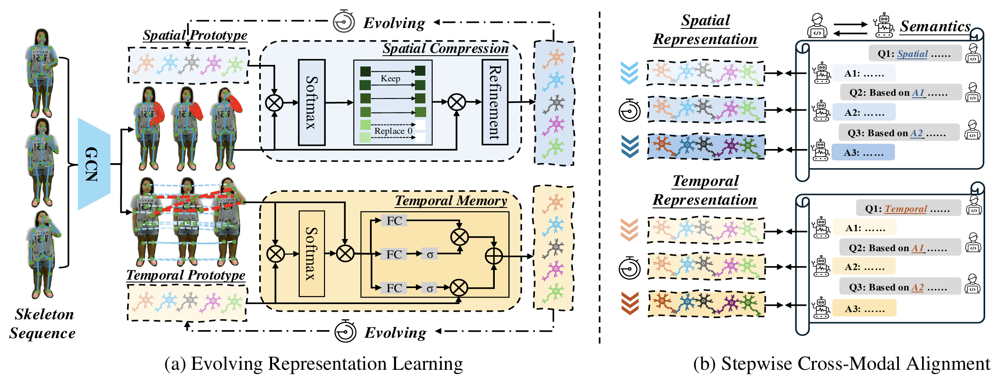

# Thesis: Neuron++ zero-shot model on Neuron

Copy of [Neuron](https://github.com/cseeyangchen/Neuron) (CVPR 2025) with upgrades on top of its head (stage 1: text side, description pooling, losses). The earlier neuro-symbolic branch (primitives + rules) was removed: its rule ceiling (`zsl_oracle` 61% on 55/5) was below Neuron's own accuracy; it is in git history (commit 51002aa).

New files:
- `model/neuron_plus.py`: `NeuronPlus` = Neuron's visual head (unchanged) + low-rank text adapter, class graph (propagation of text embeddings, hard negatives), description pooling (mean / max / lse) and the losses `ce`, `xnce` (InfoCPL), `cal` (FS-VAE calibrated alignment), `tri` (TDSM triplet margin). Defaults reproduce Neuron's head and CE.
- `main_plus.py`, `config/plus/*.yaml`: training / evaluation (single prediction per sample; Neuron's OR accuracy is logged as `zsl_neuron_or` only). Default `feature_mode: cache`: the frozen encoder runs once, each training sample gets one fixed augmentation (seeded per sample), test uses the centre crop. Checkpoints: `last.pt` every epoch (auto-resume), `best.pt` at max `best_metric`. `cache_device: auto` puts the cubes on GPU, RAM or a memory-mapped file on disk depending on free memory. `eval_alphas` adds ZSL columns with test-time class-graph propagation. Colab notebook: `../neuron_plus.ipynb`.
- `feeders/feeder_ntu_mmap.py`: `Feeder_Mmap`, memory-mapped `.npy` version of `Feeder_Shiftgcn_Match` (same samples and augmentation, RAM ~1-2 GB instead of ~14 GB for NTU60), so it also runs on a T4.

Changes to upstream files (no change in computation):
- `model/shiftgcn_match.py`: Shift imported by package path (the old `sys.path` + `from cuda.shift` import collides with `cuda-python` on Colab); `np.int` -> `int`; `ModelMatch.forward` split into encoder + `neural_logits(cube, ...)`, and the visual half of the head is `visual_vectors(cube)`; mask created on the input's device instead of `.cuda()`.
- `model/Temporal_shift/cuda/shift.py`: pure-PyTorch Shift (default, no CUDA build). `SHIFT_BACKEND=cuda` uses the compiled kernel.
- `feeders/tools.py`: `np.random.rand(1)` -> `np.random.rand()` (numpy 2.x).
- `.gitignore`: `config/` and `semantics/` are tracked (needed on Colab); CUDA build artifacts are ignored.

The original Neuron README follows.

---

# Neuron
This repo is the official implementation for [Neuron: Learning context-aware evolving representations for zero-shot skeleton action recognition](https://openaccess.thecvf.com/content/CVPR2025/html/Chen_Neuron_Learning_Context-Aware_Evolving_Representations_for_Zero-Shot_Skeleton_Action_Recognition_CVPR_2025_paper.html). The paper is accepted to **CVPR 2025**.

## Framework


## Data Preparation

### Download datasets.

#### There are 3 datasets to download:

- NTU RGB+D 60 Skeleton
- NTU RGB+D 120 Skeleton
- PKU-MMD

#### NTU RGB+D 60 and 120

1. Request dataset here: https://rose1.ntu.edu.sg/dataset/actionRecognition
2. Download the skeleton-only datasets:
   1. `nturgbd_skeletons_s001_to_s017.zip` (NTU RGB+D 60)
   2. `nturgbd_skeletons_s018_to_s032.zip` (NTU RGB+D 120)
   3. Extract above files to `./data/nturgbd_raw`

#### PKU MMD

1. Request and download the dataset [here](https://www.icst.pku.edu.cn/struct/Projects/PKUMMD.html)
2. Unzip all skeleton files from `Skeleton.7z` to `./data/pkummd_raw/part1`
3. Unzip all label files from `Label_PKUMMD.7z` to `./data/pkummd_raw/part1`
3. Unzip all skeleton files from `Skeleton_v2.7z` to `./data/pkummd_raw/part2`
4. Unzip all label files from `Label_PKUMMD_v2.7z` to `./data/pkummd_raw/part2`


### Data Processing

#### Directory Structure

Put downloaded data into the following directory structure:

```
- data/
  - NW-UCLA/
    - all_sqe
      ... # raw data of NW-UCLA
  - ntu/
  - ntu120/
  - nturgbd_raw/
    - nturgb+d_skeletons/     # from `nturgbd_skeletons_s001_to_s017.zip`
      ...
    - nturgb+d_skeletons120/  # from `nturgbd_skeletons_s018_to_s032.zip`
      ...
```

#### Generating Data

- Generate NTU RGB+D 60 or NTU RGB+D 120 dataset:

```
 cd ./data/ntu60 # or cd ./data/ntu120
 # Get skeleton of each performer
 python get_raw_skes_data.py
 # Remove the bad skeleton 
 python get_raw_denoised_data.py
 # Transform the skeleton to the center of the first frame
 python seq_transformation.py
```

- Generate PKU MMD I or PKU MMD II dataset:
```
 cd ./data/pkummd/part1 # or cd ./data/pkummd/part2
 mkdir skeleton_pku_v1 or mkdir skeleton_pku_v2
 # Get skeleton of each performer
 python pku_part1_skeleton.py or python pku_part2_skeleton.py
 # Transform the skeleton to the center of the first frame
 python pku_part1_gendata.py or python pku_part2_gendata.py
 # Downsample the frame to 64
 python preprocess_pku.py
 # Concatenate train data and val data into one file
 python pku_concat.py
```


## Pretrain Skeleton Encoder (Shift-GCN) for Seen Classes 

**If you would like to train Shift-GCN yourself, you may follow the procedure below：**

- For NTU RGB+D 60 dataset (55/5 split):
```
 cd Pretrain_Shift_GCN
 python main.py --config config/ntu60_xsub_seen55_unseen5.yaml
```

- For PKU-MMD I dataset (46/5 split):
```
 cd Pretrain_Shift_GCN
 python main.py --config config/pkuv1_xsub_seen46_unseen5.yaml
```


## Shift-GCN Pretraining Weights

For your convenience, **pretrained weights for the Shift-GCN encoder** are available for download from [BaiduDisk](https://pan.baidu.com/s/1Pad1U7ISFgHM-v4z-WdCAg?pwd=v35w) or [Google Drive](https://drive.google.com/file/d/1KOBBElm2QzWjMyQJwVhGyq06ezp8rOLX/view?usp=sharing), in case you’d prefer not to train it from scratch.


## Training 

- For NTU RGB+D 60 dataset (55/5 split):
```
 python main_match.py --config config/ntu60_xsub_55_5split/joint_shiftgcn_ViTL14@336px_match.yaml
```

- For PKU-MMD I dataset (46/5 split):
```
 python main_match.py --config config/pkuv1_xsub_46_5split/joint_shiftgcn_ViTL14@336px_match.yaml
```

## Acknowledgements
This repo is based on [CTR-GCN](https://github.com/Uason-Chen/CTR-GCN), [GAP](https://github.com/MartinXM/GAP), and [STAR](https://github.com/cseeyangchen/STAR). The data processing is borrowed from [CTR-GCN](https://github.com/Uason-Chen/CTR-GCN), [AimCLR](https://github.com/Levigty/AimCLR), and [STAR](https://github.com/cseeyangchen/STAR).

Thanks to the original authors for their work!

## Citation

Please cite this work if you find it useful:.
```
@inproceedings{chen2025neuron,
  title={Neuron: Learning context-aware evolving representations for zero-shot skeleton action recognition},
  author={Chen, Yang and Guo, Jingcai and Guo, Song and Tao, Dacheng},
  booktitle={Proceedings of the Computer Vision and Pattern Recognition Conference},
  pages={8721--8730},
  year={2025}
}
```
